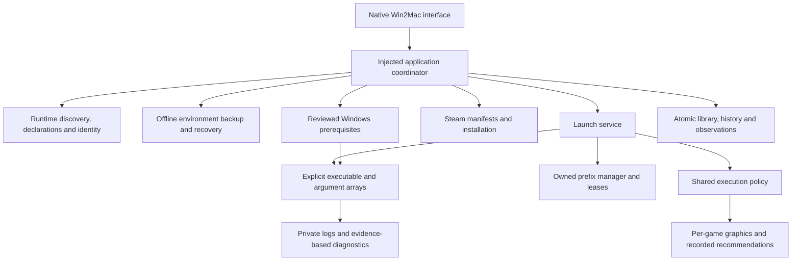

# Win2Mac 0.3 source rebuild

This working tree adds the compatibility services below to the existing native app. It is not a published or notarized build. Older downloadable Bridge previews do not contain these changes. See the [pre-refactor audit](REBUILD_AUDIT.md).

## Architecture

Services live in `Sources/BridgeCore`, use injectable protocols, compile under Swift 6 concurrency and avoid shell-based Windows execution. SwiftUI handles selection and consent rather than implementing dependency, prefix or launch policies. `BridgeCore`, the Xcode target/scheme and the legacy `Application Support/Bridge` data location remain named Bridge to preserve existing integrations and user data. The generated application product and visible interface are **Win2Mac.app**.

## Delivered and regression-covered

| Subsystem | Behavior | Evidence boundary |
| --- | --- | --- |
| Runtime | Passive discovery; explicit provider metadata; multiple registered identities; SHA-256 pinning on settings save or approved probe; changed engines refused; existing associations never auto-updated | Primary executable identity only. A checksum does not authenticate its publisher, wrapper payload or adjacent libraries. A functioning previous provider installation must be retained for actual runtime rollback. |
| Architecture | Existing bounded x86/x64/ARM64/ARM64EC/CLR parser retained; x86 requires provider-confirmed WoW64 in win64 prefixes; DLL inspection supports dependency evidence | Rosetta runtime-file presence is a prerequisite hint. ARM Windows execution and proprietary adapters remain unsupported. |
| Execution | One environment policy for approvals and launches; removes inherited prefix, graphics, loader and other-distribution Wine component overrides; rejects NUL/invalid native process requests | Ordinary provider environment remains available. Stop supervises the immediate child, not every detached Wine process. |
| Isolation | Per-application graphics/arguments/environment/working directory; prefix DLL changes cannot be disguised as per-game overrides; incompatible DXVK changes fail before execution | Steam must share its authenticated client/environment. Close Steam before changing child environments; an existing client may ignore them. |
| Recovery | Offline full-prefix backups with SHA-256 file manifests and saved per-app settings; duplication preserves symlinks without traversing host mappings; restore retains current files in a sibling directory; pending journals block launch/repair | External Wine processes must be closed. Snapshots include games/saves and need disk space. Uncompleted restore journals require manual inspection; no unattended overwrite or deletion. Imported DXVK must be restored before duplication. |
| Configuration | Reviewed Wine `winecfg -v` Windows-version requests; fresh-environment reset reassigns only the selected standalone app and retains its old environment | Windows version selection does not install Windows or add unsupported APIs. Wine command behavior must be checked on the selected provider. |
| Dependencies | Explicit local Microsoft VC 2015–2022, DirectX June 2010 and .NET Framework 4 installers; captured bytes and adjacent DirectX payloads verified; target payload architecture selected independently from bootstrapper architecture; persistent pending/failure/unverified/file-evidence journal; intact identical successful attempts are reused | No automatic downloads or Authenticode verification. Select official component editions supported by the game and provider. Matching native PE files, architecture and hashes verify presence, not installed version/functionality. .NET header presence does not establish which .NET edition is required. |
| Steam | Reviewed local Valve installer, uncertain-outcome journal, installed client scan, bounded KeyValues/ACF parsing, conventional C: library mapping, installed-game import, local artwork, explicit `-applaunch` routing and client launch | No credential handling, DRM bypass, online catalog, arbitrary host drive traversal, or anti-cheat guarantee. Client checksum is not a game checksum. Steam game's actual executable architecture remains unknown unless inspected separately. |
| Diagnostics | Saved category/confidence/evidence; specific Steam authentication and protection failures; incidental mentions and exit 3 remain unexplained; complete private logs; bounded UI; per-run state/duration/context; interrupted sessions never auto-restart | Diagnoses based on output are probable. No root cause is invented for Isaac/CARL. Native crash-report discovery, process-tree resource telemetry and reliable game FPS are not implemented. |
| Compatibility | Explicit dated launch/rendering/input/audio/stability observations; JSON matrix export; playable/full status requires subsystem observations; same-byte/engine/OS observed graphics recommendations | No game is certified by unit tests, process start, exit zero or an engine probe. Steam client observations do not trigger automatic game-byte recommendations. |
| Native UI | Home, Library, Steam, Applications, Compatibility, Diagnostics and Settings; dark default, local game artwork/details, recovery menus, prerequisite controls, compatibility recording, advanced settings | Swift parsing was checked on Linux. Actual SwiftUI/AppKit compilation, UI interaction/accessibility and window startup need macOS. |

## Current provider evaluation

Read the current Gcenx macOS Wine README and Homebrew `wine-stable` cask over verified HTTPS on 2026-10-14. The README documents Intel-host builds, 32/64-bit Windows support, manual app installation and MacPorts-derived dependencies. The cask lists `11.0_1`, requires Rosetta and is disabled effective 2026-09-01 for `fails_gatekeeper_check`. These facts do not establish game compatibility or permit bypassing Gatekeeper. No engine is selected, downloaded or bundled by this rebuild. Users must check the provider's OS, dependency and licensing requirements for their installed version.

CodeWeavers and Apple toolkit pages returned HTTP 403 from this environment. Their current terms and compatibility could not be verified here. CrossOver and GPT/D3DMetal therefore remain provider-owned, unavailable adapters; no private binary integration or redistribution is asserted. Wine's license does not automatically license every component of a distribution. See [runtime setup](RUNTIME_SETUP.md), [DXVK layout](DXVK_SETUP.md), and each provider's official requirements.

## How to use the source

On Apple Silicon, install full Xcode 16+, then run `bash scripts/run_macos.sh` or open `Bridge.xcodeproj` and run its Bridge scheme. The script builds/tests and opens `Win2Mac.app`; ordinary use needs no Terminal commands. SwiftPM `swift run Bridge` remains the internal development executable name. Native test target also compiles the actual app model behind `BRIDGE_MODEL_TESTS`.

1. Compatibility: select a separately installed documented Wine CLI, choose provider/host/guest declarations and save. Approve an optional version probe. Existing runtime associations remain unchanged. Register a changed executable as a separate revision; keep the old complete installation if rollback is needed.
2. Applications/Library: add a trusted Windows EXE. Play selects a configured runtime and requests approval before preparing a dedicated environment. Advanced settings hold this app's arguments, overrides and graphics. Known-working settings are retained rather than cycling backends.
3. Settings → Environments: create/associate an environment, back up while offline, duplicate, review Windows-version changes, or restore a listed backup. Restore affects every app sharing that prefix and retains the current directory. Fresh reset in an app's settings creates a new environment without deleting old saves/files. Applications installed inside the old prefix are not magically reinstalled in the new one; rerun their official installer or import the new installation.
4. Prerequisites: select only the needed component, publisher-reported version and target x86/x64 edition. Obtain the official installer via the link, choose it and review the captured command. DirectX needs extracted DXSETUP.exe with its adjacent official DLL/CAB payload. Back up first. An uncertain attempt blocks another run until explicitly reviewed.
5. Steam: choose/create a dedicated initialized environment, install a downloaded official Valve installer with consent, detect client/games, sign in inside Windows Steam, then import games into Library. C: libraries are supported. External drive mappings, nonstandard client paths or installations can be imported as standalone applications; they are not silently traversed by the Steam scanner. Kernel anti-cheat and DRM require publisher support, with no bypass.
6. After actual testing, record observed rendering, input, audio and stability in the game detail page. Export the compatibility matrix as needed. A Steam entry launches the client; its record does not pretend to identify every game binary.

For a source-built package on macOS, set `BRIDGE_PACKAGE_DIR` to an external output directory and run `bash scripts/package_macos.sh`. It produces `Win2Mac-macOS-arm64.zip` with static core linkage, hardened ad hoc signing, architecture/signature checks and extracted-app window verification. Ad hoc signing is not Developer ID signing or notarization. Publishing requires the existing release workflow/user action; nothing was pushed or published here.

Linux: `bash scripts/test_linux.sh` builds and runs backend XCTest with four jobs, using external caches. No Wine/EXE/Steam installer is executed by mocked tests. Existing Foundation process tests do exercise real harmless Linux child processes for pipes, cancellation and timeouts.

## Verification and remaining acceptance work

Current Linux Swift 6.0.3 run: **85 backend XCTest cases passed, zero failures** (51 existing + 34 new). The separate trailing Swift Testing runner contains zero tests; it is not the basis for the result. Two new macOS model cases extend the seven existing cases; **all nine native model cases are unrun here**. Historical macOS release outcomes do not validate this source revision.

Optimized `BridgeCore` production build also passed with four jobs. Swift app/model parsing, script syntax, generated source membership, static linkage/model-test settings, product/scheme references and deterministic project regeneration passed their applicable checks. None substitutes for a native SDK build.

Required before calling this a functioning macOS/game release:

- Build and run native Xcode XCTest on Apple Silicon with Xcode 16+; run `scripts/package_macos.sh` and its extracted-app window check. Verify dark UI, pickers, dialogs, control accessibility and retained legacy library data.
- Exercise the selected installed provider's Wine CLI, version probe, wineboot, winecfg, architecture/Rosetta prerequisites and actual dependency installer payloads. Confirm installer evidence represents the required component edition and functionality.
- Exercise Steam installation/login, local/multiple libraries, client updates, game launch arguments and shared-client graphics behavior. Test unsupported drive mappings and authentication failures without losing logs/data.
- Test offline backup/restore/duplication/reset on real prefixes with saves, DLL journals, symbolic links and deliberate interruption. Check disk exhaustion and externally running Wine; application leases are not OS-wide locks. Recovery's retained previous sibling contains original saves even if the newly restored prefix differs.
- Supply legal test applications/games and run the matrix below. Neither Isaac's exit 3 nor CARL's compatibility is resolved by these backend changes.

| Actual application | Architecture | Runtime/version | Graphics | Launch | Rendering | Input | Audio | Stability | Status |
| --- | --- | --- | --- | --- | --- | --- | --- | --- | --- |
| x86 Windows diagnostic app (not supplied) | x86 intended | Not tested | Not tested | Not tested | Not tested | Not tested | Not tested | Not tested | Not tested |
| x64 Windows diagnostic app (not supplied) | x64 intended | Not tested | Not tested | Not tested | Not tested | Not tested | Not tested | Not tested | Not tested |
| Windows Steam | Client/version not supplied | Not tested | Not tested | Not tested | Not tested | Not tested | Not tested | Not tested | Not tested |
| CARL | Actual binary not supplied | Not tested | Existing settings preserved | Not tested | Not tested | Not tested | Not tested | Not tested | Not tested in this revision |
| Isaac | Actual edition/binary not supplied | Not tested | Not tested | Historical exit 3; no current run | Not tested | Not tested | Not tested | Not tested | Unresolved; no current test |

Automated engine downloading/updates, provider-specific commercial adapters, Authenticode verification, universal game profiles, arbitrary .NET generations, Windows ARM execution, native registry editing beyond reviewed winecfg, system-wide locks, full descendant supervision, online Steam artwork/catalog, automatic native crash-report collection and game performance telemetry are not delivered. These need provider-specific work and hardware evidence rather than speculative patches.
